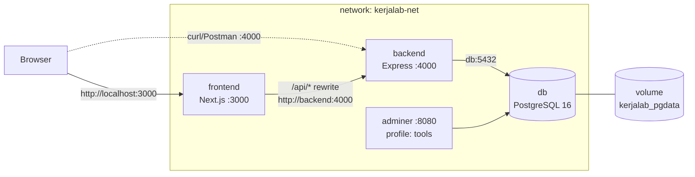

# KerjaLab — Simulasi Kerja Berbasis Web

> Coba pekerjaan impianmu lewat simulasi, **tanpa penalti**. Aplikasi multi-tier (Next.js + Express + PostgreSQL) yang berjalan penuh di Docker Compose pada localhost.

## Deskripsi & alasan projek
Banyak job hunter (terutama mahasiswa/fresh graduate) bingung dengan ekspektasi dunia kerja nyata, dan perusahaan sulit menilai kompetensi hard/soft skill hanya dari CV. KerjaLab memberi ruang aman untuk berlatih: pengguna memilih bidang (Teknologi, Sains, Bisnis, Soft Skill), mengerjakan simulasi bertingkat dengan batas waktu, lalu mendapat **koin** (kustomisasi profil) dan **XP** (level skill yang tampil di profil).

Fitur yang sudah ada:
- Login Google (OAuth) **atau** mode dev lokal tanpa Google, dengan persetujuan data pribadi eksplisit (UU No. 27/2022)
- 12 simulasi di 4 bidang, 3 tingkat kesulitan (makin sulit → hadiah makin besar), batas waktu per simulasi
- Gagal boleh coba ulang tanpa penalti; hadiah dasar diberikan saat pertama kali lulus
- Tantangan harian + streak (bonus koin harian)
- Profil: level hard/soft skill, jumlah & total waktu simulasi, link LinkedIn/GitHub, opt-in berbagi ke perusahaan, toko tema (koin), hapus akun & data (Right to Erasure)

## Arsitektur

Hanya `frontend` (3000), `backend` (4000, untuk uji curl) dan `adminer` (8080, profile `tools`) yang dibuka ke localhost. Database **tidak** dipublikasikan.

## Cara menjalankan
Prasyarat: Docker + Docker Compose v2.
```bash
git clone <URL-REPO-ANDA>
cd kerjalab
cp .env.example .env          # lalu ganti password & JWT_SECRET
docker compose up -d --build
```
Buka <http://localhost:3000>. Dengan `AUTH_MODE=dev` (default), login memakai nama + email dummy.

Perintah berguna:
```bash
docker compose ps                         # status service (db harus healthy)
curl -i http://localhost:4000/health      # 200 {"status":"ok"}
docker compose --profile tools up -d      # + Adminer di http://localhost:8080 (server: db)
docker compose down                       # hentikan, DATA TETAP ADA
docker compose down -v                    # hentikan + HAPUS volume (data hilang)
```

### Login Google (opsional)
1. Google Cloud Console → APIs & Services → Credentials → *OAuth client ID* (Web application), Authorized JavaScript origins: `http://localhost:3000`.
2. Di `.env`: `AUTH_MODE=google` dan `GOOGLE_CLIENT_ID=<client id>` lalu `docker compose up -d --build`.

## Endpoint utama
| Method | Path | Keterangan | Status |
|---|---|---|---|
| GET | `/health` | health check + cek DB | 200 / 503 |
| GET | `/api/simulations` | daftar simulasi (baca) | 200 |
| POST | `/api/simulations/:id/start` | mulai percobaan (tulis ke DB) | 201 |
| POST | `/api/attempts/:id/submit` | kirim jawaban, hitung skor & hadiah | 200 / 409 |
| GET | `/api/daily` | tantangan harian + streak | 200 |
| GET/PATCH/DELETE | `/api/me` | profil, ubah profil, hapus data | 200 / 204 |

Semua `/api/*` selain `/api/config` dan `/api/auth/*` memerlukan header `Authorization: Bearer <token>`.

## Struktur
```
backend/   Express + pg (Dockerfile multi-stage, .dockerignore)
frontend/  Next.js standalone (Dockerfile 3 stage, .dockerignore)
docker-compose.yml   .env.example   docs/
```

## Screenshot
_(isi: docker compose ps, curl 200/201, uji persistensi, tampilan aplikasi)_

## Tautan
- Artikel: _(isi)_
- Video YouTube: _(isi)_

## Sumber & atribusi
Next.js, React, Express, node-postgres, google-auth-library, jsonwebtoken (open-source, lisensi MIT/Apache). Starter: `npm init` / struktur `app/` Next.js standar. Gambar Docker resmi: `node`, `postgres`, `adminer`.

## AI Usage Declaration
_(isi sesuai ketentuan: alat yang dipakai, bagian yang dibantu, contoh prompt utama)_
